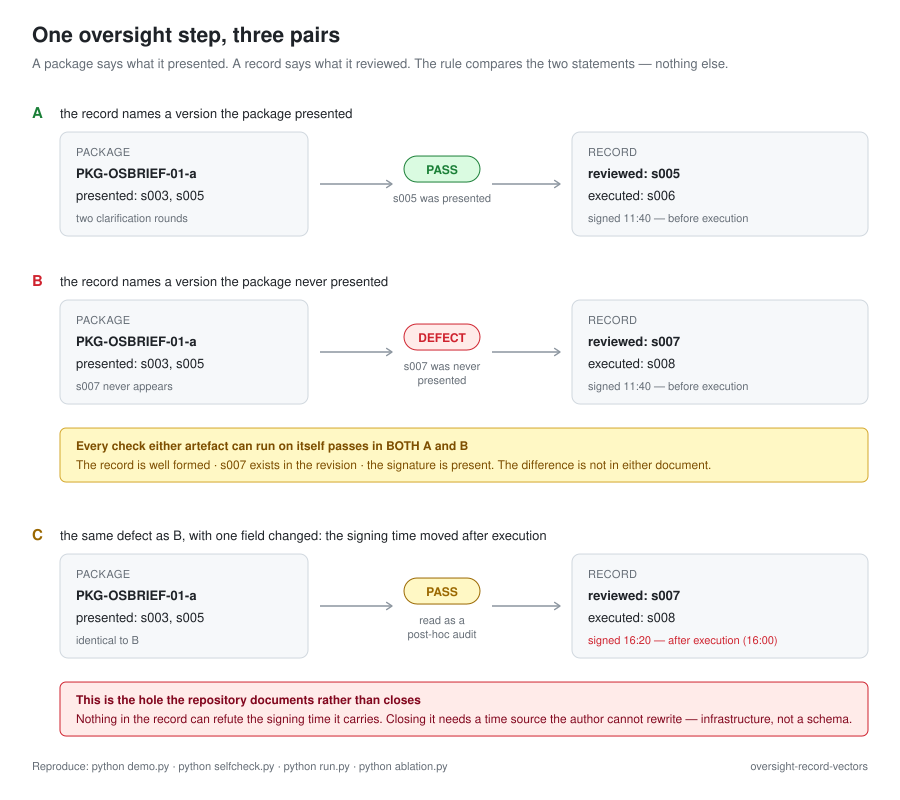

# Oversight-record vectors

A small reference implementation and a fourteen-record fixture, made to answer one question:

> Can a later party tell, from the records alone, whether the state version that an oversight decision cites is a version the human reviewer actually saw?

This repository accompanies a comment posted to the ITU-T Focus Group on Trust and Identity for Humans and Agentic AI (FG-TIDA), issue #16. It exists so that the numbers in that comment can be re-run rather than taken on trust.



## What it measures

A record is treated as defective under a rule, and the rule is checked against a fixture in which the truth is known:

- **B1** — the rule as originally proposed: is the reviewed version among the versions the case revision permits?
- **B2a** — the same rule with identity normalisation via a *declared* alias table, an act type derived from timestamps, and the presented set kept as a set
- **B2b** — as B2a, but normalisation only accepts a hash recomputed from the version content

| variant | false positives | false negatives |
|---|---|---|
| B1 (as proposed) | 4 | 0 |
| B2a (declared aliases) | 0 | 2 |
| B2b (recomputed hashes) | 0 | 1 |

The fixture holds 14 records: 5 defective, 8 legitimate, 1 ambiguous (counted separately, not into FP or FN).

## Why the rule fails

One membership test is being asked to do three jobs: establish that two names denote the same version, establish which kind of act the record describes, and establish what the package presented.

The clearest failure is not about tuning. For a deferred action the executed version is not reviewable by construction, so a record whose reviewed version *is* the executed version — which is what a post-hoc audit is — necessarily fails the rule.

## What is left unfixed

One defect still escapes: a pre-decision whose signing time is written after execution. The rule derives "post-hoc audit" and takes the lenient branch. Deriving the act type from the signing time is circular — the timestamp decides the branch and can never contradict it. `run.py` prints the always-true table that shows this.

There is no missing field. What is missing is a time source the author cannot rewrite. That is infrastructure, not a schema.

**Scope of the claim.** This is a consistency check on the record, not a truth check about the world. It detects disagreement between the fields of one record, and between two artefacts that reference the same case. It does not detect disagreement between a record and reality.

## Running it

```
python demo.py        # one oversight step, walked end to end (three scenarios)
python selfcheck.py   # the repository's own evaluation - asserts every number below
python run.py         # the B1 / B2a / B2b tables, the counts, and the circularity check
python ablation.py    # per-field ablation, producing the last column of FIELD_LIST.md
```

No dependencies beyond the Python standard library.

**`demo.py`** prints, for three scenarios against the same case revision: what the package says, what the record says, what each artefact can establish on its own, and what the cross-artefact rule concludes. Scenario B is the defect; scenario C is the documented hole.

**`examples/`** holds the same three cases as standalone JSON pairs, each with an `expected` verdict and a note on what a reader should see. Start with `examples/README.md`.

**`selfcheck.py`** is the evaluation. It asserts the counts in this file, the ablation table in `FIELD_LIST.md`, every example's verdict, and the demo's outcome — and it includes a deliberate negative control that must fail, so that a silent breakage cannot pass. Exit code is 0 only if all of that holds.

`FIELD_LIST.md` lists the minimum fields the rule needs, who would have to produce each one, and what happens when it is missing — measured, not inferred.

The `@{hash:sNNN}` and `@{ts:sNNN}` markers in `fixtures/records.json` are placeholders that `run.py` substitutes with real values at load time.

## Provenance

Prepared by Xinghua Zhao, independent expert, in an individual capacity.
ORCID [0009-0001-0512-1237](https://orcid.org/0009-0001-0512-1237).

The fixture is synthetic. It is not drawn from any particular product, and it is not a claim about how any deployed system behaves.
